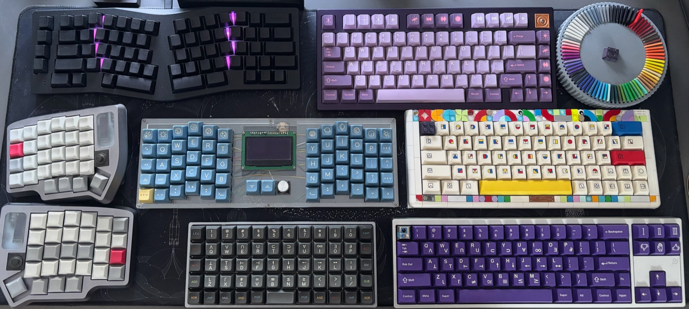

# Eric Boettner

  

Keyboard enthusiast and programmer with a love for automation and productivity tools.

I use my personal github to maintain my development setup and contribute to projects that I use every day. Feel free to contribute to any of my projects or create an issue if you need help getting anything working.

Learn more about me at [ericboettner.dev](https://ericboettner.dev)

### What I tinker with

- **Keyboards**: [Thesis](https://github.com/Boettner-eric/Thesis), on encrypting keystrokes on keyboard microcontrollers
- **Shortcuts**: [Alfred workflows](https://github.com/Boettner-eric/Alfred) and [Bindy](https://github.com/Boettner-eric/Bindy) for keyboard shortcuts on any site
- **Obsidian**: gists for a [day/week split view](https://gist.github.com/Boettner-eric/d08218aaaeb411c614a98ee6ae4728bd), [pulling in Google Calendar events](https://gist.github.com/Boettner-eric/41cabaa207ba4d257478f1d9a7985db2) and [toggling frontmatter](https://gist.github.com/Boettner-eric/e15deae15ccae8605c5fcfc953e55de2)

Most Decembers I participate in [Advent of Code](https://github.com/Boettner-eric/Advent-of-Code-2025) in various languages.
